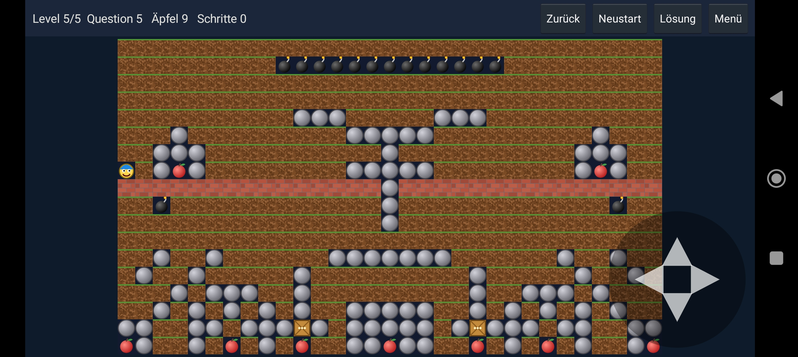

UPDATE:
HTML Version available here:

https://zettelmuseum.github.io/MrMatt/

This is a single, self-contained 1MB html file.
3885 levels with solutions.
Note that you can adjust the zoom level from the menu.

This is the turn-based Boulderdash-Like
Mr.Matt by Andrzej Wrotniak, ported to Android.
3,885 levels and solution replays, all tested

This is something ultra rare you won't find
anywhere else!

This game disappeared from the internet sometime around 2007. Luckily I still had a local copy including all levels and replays.

This is not a remake but a 1:1 port of the original game logic. All levels and replays are 100% tested.

See NOTES.md for details.

APK file is included.

This was created with a "little" help by claud.

A mirror if the original pages is still available here:

https://mikeeckman.com/wrotniak/works/mrmatt/

Mr.Wrotniak, if you are still alive,
I hope you don't mind!
